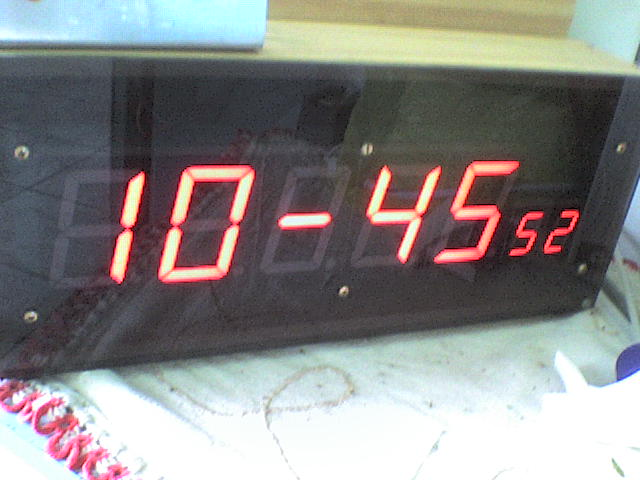
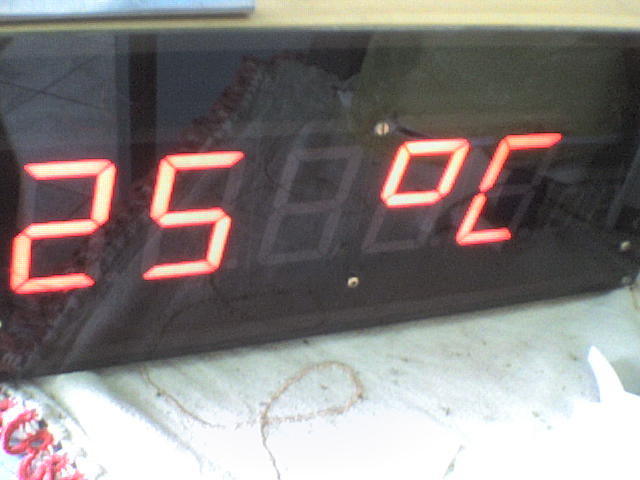

# Displayzão — a big 7-segment LED clock on a PIC16F877A

> *Displayzão* is Brazilian Portuguese for "the big honking display".

A wall clock built in **June 2007** around a **PIC16F877A** and a salvaged
LED display module pulled out of a scrapped slot machine. It shows the time
as `HH-MM ss` and, every few seconds, switches over to the ambient
temperature. It has a settable alarm and four front buttons.

This was one of my first serious projects in C. The firmware is published
**as it was written in 2007** — comments in Portuguese, CCS-specific
compiler syntax and all. The only change made for this repository was
re-encoding the sources from CP1252 to UTF-8 so the accented comments
render correctly on GitHub. Not a single line of logic was touched.

| Time | Temperature |
|---|---|
|  |  |

---

## 1. What the thing is

The display module came out of a slot machine and was a gift from my friend
**Márcio Rossi**. It carries **seven common-anode 7-segment digits** in an
unusual arrangement:

```
   d0   d1   d2   d3   d4      d5  d6
  ┌──┐ ┌──┐ ┌──┐ ┌──┐ ┌──┐    ┌─┐ ┌─┐
  │  │ │  │ │  │ │  │ │  │    │ │ │ │      <- 5 large + 2 small
  └──┘ └──┘ └──┘ └──┘ └──┘    └─┘ └─┘
    H    H    -    M    M       s   s
```

* **d0 … d4** — large digits, **TOS-23101 series**, 2.3 in (~58 mm) character
  height. Each segment is a *series string* of several LEDs, which is why the
  segment side runs off **+12 V** and not off the PIC's 5 V rail.
* **d5, d6** — small digits, **TOS-1106 series**, 1.0 in (25.4 mm).
* `d0` is the leftmost digit, `d6` the rightmost. That numbering is used
  everywhere in the firmware.

Scans of both datasheets are in [`docs/`](docs/).

Two display modes alternate automatically:

| Mode | Duration | Layout |
|---|---|---|
| Time | ≈ 7 s | `HH-MM ss`, the dash on `d2` blinking at ≈ 0.7 Hz |
| Temperature | ≈ 3 s | `TT ºC` on `d0 d1 _ d3 d4`, leading zero blanked |

---

## 2. Hardware

| Block | Part | Notes |
|---|---|---|
| MCU | PIC16F877A | 12 MHz HS crystal → 3 MIPS |
| RTC | **HT1380** (Holtek) | 3-wire serial; pin- and protocol-compatible with the DS1302 minus the scratchpad RAM |
| Segment driver | ULN2803A | Darlington **sink** array, pulls the segment cathodes down |
| Digit decoder | 74LS238 | 1-of-8 **non-inverting** decoder/demultiplexer (unlike the more familiar '138) |
| Digit switch | ULN2803A → TIP125 (PNP Darlington) | see below |
| Temperature sensor | TMP36 | 10 mV/°C, 500 mV @ 0 °C, analogue output into AN0 |
| Rails | +5 V and +12 V | logic on 5 V, LED segments on 12 V |

The digit-select chain needs one extra stage that is easy to miss. The
74LS238's outputs are **active high**, but a TIP125 is a PNP device whose base
must be pulled *low* to conduct. So the decoder output drives a second
ULN2803A, whose Darlington sinks the TIP125 base to ground and switches the
+12 V rail onto that digit's common anode.

Schematic: [`hardware/relog_displayzao.sch`](hardware/relog_displayzao.sch)
— **CadSoft EAGLE binary format** (v4/v5 era). See
[§8 Known limitations](#8-known-limitations-and-quirks) about viewing it today.

### Pin map

| Pin(s) | Direction | Function |
|---|---|---|
| `RB0…RB6` | out | Segments **A…G**, via ULN2803A |
| `RB7` | out | Decimal point (DP) |
| `RD7` | out | 74LS238 enable |
| `RD6:RD4` | out | 74LS238 address — selects which digit is lit |
| `RD2` | in | **INC** button |
| `RD3` | in | **DEC** button |
| `RC0` | out | HT1380 `RST` (chip enable) |
| `RC1` | in/out | HT1380 `I/O` (bidirectional data) |
| `RC2` | out | HT1380 `SCLK` |
| `RC4` | in | **ENTER** button |
| `RC5` | in | **CANCEL** button — wired, but unused by the firmware |
| `RA0/AN0` | analogue in | TMP36 output |
| `RE1` | out | Alarm buzzer |
| `RE2` | out | Spare output, unused |

The digit-select encoding is worth spelling out, because output `Y0` of the
decoder is deliberately wasted:

| Digit | `RD7` (enable) | `RD6 RD5 RD4` | 74LS238 output |
|---|---|---|---|
| d0 | 1 | 0 0 1 | Y1 |
| d1 | 1 | 0 1 0 | Y2 |
| d2 | 1 | 0 1 1 | Y3 |
| d3 | 1 | 1 0 0 | Y4 |
| d4 | 1 | 1 0 1 | Y5 |
| d5 | 1 | 1 1 0 | Y6 |
| d6 | 1 | 1 1 1 | Y7 |

---

## 3. Display multiplexing

All seven digits share one segment bus, so they are time-multiplexed from
the **Timer0 interrupt**.

**Assumptions and numbers** (F<sub>OSC</sub> = 12 MHz, so T<sub>CY</sub> = 333.3 ns):

```
Timer0 source    : internal instruction clock
Prescaler        : 1:16                    ->  5.33 µs per tick
Rollover         : 256 ticks               ->  1.365 ms per interrupt
Digits           : 7
Full frame       : 7 × 1.365 ms = 9.56 ms  ->  ~105 Hz refresh rate
Duty per digit   : 1/7 ≈ 14 %
```

105 Hz is comfortably above the flicker fusion threshold, and the 14 % duty
is why the segments are driven hard from the 12 V rail.

Each interrupt does exactly three things:

1. Blank **all** digits (`PORTD<7:4> = 0`) — this is the dead time that
   prevents ghosting between digits.
2. Put the next digit's segment pattern on `PORTB` and assert its decoder
   address.
3. Advance the digit counter and set `flg_tmr0`.

### Segment lookup table

`tab_display[]` maps a value to a segment pattern, bit 0 = segment A …
bit 6 = segment G, bit 7 = DP. Besides `0…9` it carries the glyphs the user
interface needs: `H`, `C`, `º`, `-`, blank, `r`, `A`, `L`.

### Tear-free buffer updates

The main loop never writes `d0…d6` blindly. It does this first:

```c
flg_tmr0 = 0;
while (!flg_tmr0);   /* wait until the ISR has just run */
/* ... now update d0..d6 ... */
```

This synchronises the update to immediately *after* a digit refresh, so a
half-updated frame can never be displayed. It costs up to 1.365 ms of
blocking in the main loop, which is free here — there is nothing else to do.

---

## 4. Timekeeping

The RTC is an **HT1380**. The CCS driver `DS1302.C` is used unmodified: the
HT1380 speaks the same 3-wire protocol, it simply lacks the DS1302's 31 bytes
of scratchpad RAM, which this project never uses.

Time comes back **BCD-packed**, so the firmware splits it with nibble
operations and indexes the segment table directly:

```c
d0 = tab_display[hora   >> 4];
d1 = tab_display[hora   & 15];
d2 = tab_display[traco];         /* the '-' separator */
d3 = tab_display[minuto >> 4];
d4 = tab_display[minuto & 15];
d5 = tab_display[segundo >> 4];
d6 = tab_display[segundo & 15];
```

Note that the RTC transfer is bit-banged from the main loop **without
masking the display interrupt**. Every byte gets chopped up by the 1.365 ms
refresh ISR. That is harmless: the HT1380 is fully static CMOS, so an
arbitrarily stretched clock is still a valid clock.

Only hours and minutes are ever set — the calendar is written with a dummy
date and never read back.

---

## 5. Temperature measurement

A **TMP36** on `AN0`, read with the 10-bit ADC against the 5 V rail.

**Chain of assumptions:**

```
TMP36              : 10 mV/°C, 500 mV @ 0 °C
V_ref = 5.000 V    : 5.000 / 1024 = 4.883 mV per LSB
0 °C               : 500 mV / 4.883 mV = 102.4 LSB   (the code subtracts 101)
0 … 99 °C          : 0 … 990 mV        -> 0 … 202 LSB above the offset
```

Because the offset-corrected reading spans only 0…202 counts, it is stored
in an `unsigned char` — which is exactly why the temperature range is
bounded (see §8).

**Filtering and scaling:**

* 16-sample circular buffer, refilled one sample per call.
* Average by `>> 4` (integer, so sub-count resolution is discarded).
* Scale: `°C = (avg × 49 + 50) / 100`
  * `49/100 = 0.49 °C/LSB` versus the exact `0.4883` — a 0.35 % scale error,
    which is far below the TMP36's own ±2 °C absolute accuracy.
  * The `+50` is a round-to-nearest: 17.6 °C shows as `18`, 17.4 °C as `17`.
* The buffer must be primed before the first reading is trusted, so `main()`
  calls the routine 20 times during start-up.

---

## 6. Alarm

* One alarm, hour and minute only.
* When armed, the **decimal point of `d6`** stays lit as the indicator.
* The buzzer on `RE1` is generated *inside the display ISR*, which makes it
  free of jitter and independent of whatever the main loop is doing:

```c
t_bip++;                              /* increments once per 1.365 ms ISR */
if (flg_alarmar && (t_bip & 128))     /* bit 7 gates the tone on/off */
{
    #asm
    movlw 2
    xorwf porte,f                     /* toggle RE1 */
    #endasm
}
```

Toggling `RE1` once per interrupt gives a square wave of
`1 / (2 × 1.365 ms) ≈ 366 Hz`. Bit 7 of the free-running 8-bit counter gates
it, producing **≈ 175 ms of tone followed by ≈ 175 ms of silence** — a
beep-beep-beep pattern from two lines of assembly and no extra timer.

The alarm stops on **ENTER**, or by itself once the minute rolls over. Either
way it disarms afterwards; there is no snooze and no repeat.

---

## 7. User interface

Four buttons, but the firmware only reads three: **ENTER**, **INC**, **DEC**.

| Action | How |
|---|---|
| Set the **alarm** | press **ENTER** |
| Set the **clock** | press **INC + DEC** together |

Both use the same editing routine:

1. The display shows `-----` plus a mode tag on the two small digits:
   **`hr`** for the clock, **`AL`** for the alarm.
2. The **hours** field appears on `d0 d1`. **INC** / **DEC** wrap correctly at
   `23 → 00`. **ENTER** confirms.
3. The **minutes** field appears on `d3 d4`, wrapping at `59 → 00`.
   **ENTER** confirms.
4. A confirmation screen appears — two dashes on `d1` and `d3`, everything
   else blank. **ENTER** commits the value to the RTC (or arms the alarm);
   **DEC** discards it.

Button handling is deliberately blocking — `while (bt_inc);` spins until the
key is released, followed by a 150 ms debounce delay. The display never
blanks during those spins, because refreshing it is the interrupt's job.

---

## 8. Known limitations and quirks

Kept here honestly rather than fixed, since the point of this repository is
the 2007 artefact:

1. **Temperature range is 0 … ~117 °C.** `read_adc() - 101` is stored in an
   `unsigned char`. Below 0 °C the subtraction underflows and wraps to a
   large positive number; above ~117 °C the raw count exceeds 255 and
   truncates. The clock lives indoors, so neither was ever hit.
2. **No sub-degree resolution.** The 16-sample sum is divided *before*
   scaling, so the fractional part of the average is thrown away.
3. **24-hour format only**, no calendar, no daylight saving. The date passed
   to `rtc_set_datetime()` is a fixed dummy value.
4. **Setting the time zeroes the seconds** — a side effect of the driver
   call, and arguably the correct behaviour anyway.
5. **`bt_cancel` (RC5) is wired but never read.** A feature that was planned
   and never written.
6. **The alarm does not persist.** It lives in RAM, so a power cycle clears
   it. The HT1380 has no scratchpad RAM to hide it in.
7. **The schematic is EAGLE binary.** Modern KiCad imports EAGLE *XML*
   (v6+), not this format. To view or convert it, open it in a legacy EAGLE
   release and re-save as XML, or export a PDF/PNG.
8. **Comments are in Portuguese** — the language this was thought in.
9. **The build paths are frozen in time.** The `.PJT` still points at
   `C:\Arquivos de programas\PICC\` — the install path on a Brazilian
   Portuguese Windows of 2007 — and the listing files reference a source tree
   on a drive letter that no longer exists.

---

## 9. Building

The firmware was written for the **CCS PIC C Compiler (PCM, 14-bit core)**
and built from the CCS/MPLAB IDE of the era.

```
ccsc +FM src/displayzao.c
```

Configuration fuses (`src/displayzao.h`):

```
NOWDT, HS, PUT, NOPROTECT, NODEBUG, BROWNOUT, NOLVP, NOCPD, NOWRT
```

The original 2007 build output is preserved in [`build/`](build/), including
the `.HEX` that is actually running in the clock. From `displayzao.sta`:

| Resource | Used | Occupancy |
|---|---|---|
| ROM | 1221 of 8192 words | **15 %** |
| RAM (at `main()` level) | 54 bytes | 31 % |
| RAM (worst case) | 70 bytes | **40 %** |

(The RAM percentages are the compiler's own figures, computed against the
banked general-purpose RAM the CCS allocator considers usable — not against
the 368 bytes quoted in the device datasheet.)

---

## 10. Repository layout

```
.
├── src/                     firmware sources (UTF-8; logic untouched since 2007)
│   ├── displayzao.c
│   ├── displayzao.h         fuses, port aliases, button bit definitions
│   └── displayzao.PJT       original CCS project file
├── build/                   original 2007 build output
│   ├── displayzao.HEX       the binary running in the clock
│   ├── displayzao.LST       assembly listing
│   ├── displayzao.sta       resource usage report
│   └── displayzao.cof/.SYM/.tre/.err
├── hardware/
│   └── relog_displayzao.sch EAGLE binary schematic
├── docs/                    display datasheets (TOS-23101, TOS-1106)
└── images/                  photos of the finished clock
```

---

## 11. Credits

* **Ricardo B. Morim**, June 2007 — design and firmware.
* **Márcio Rossi** — for the slot-machine display that started the whole thing.
* The `DS1302.C` driver ships with the CCS PIC C Compiler and is not
  redistributed here.
* The datasheets in `docs/` are Toshiba documents, included for reference only.
